# LocalKart

**Street vendors on your phone.** See what the cart at the corner has today and at what price, and get daily needs from the shop next door, often in about 15 minutes. For the vendor, it's a simple app that also tells them what to buy at the market tomorrow and sends the order to their trader.

Built for the **E-commerce and Digital Ecosystems** track.

| | |
|---|---|
| **Live demo** | `https://<your-github-username>.github.io/localkart/` (enable GitHub Pages, see below) |
| **Demo video** | `<YouTube or Drive link>` |
| **Slides** | [`docs/LocalKart-slides.pdf`](docs/LocalKart-slides.pdf) (add the PDF) |
| **Team** | `<Name 1>`, `<Name 2>` |

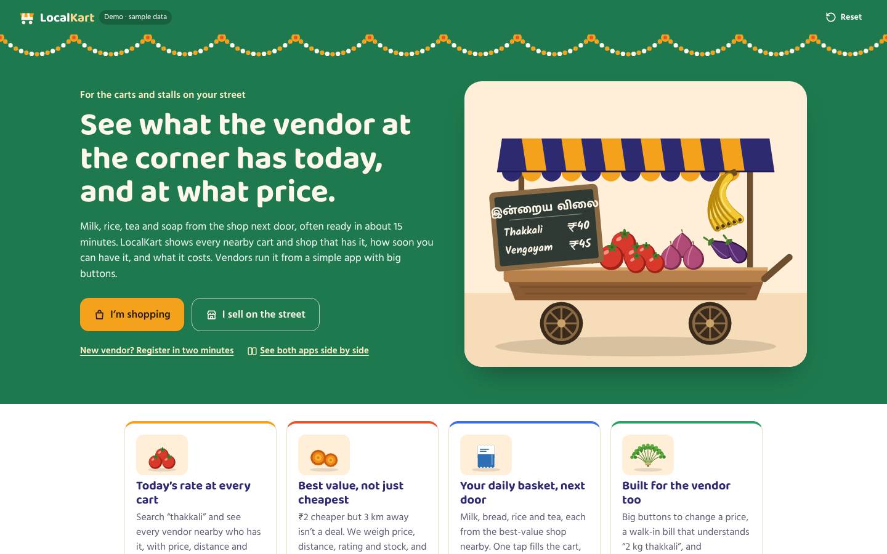

---

## The problem

Selvi sells vegetables from a cart on Kutchery Road. Customers walk past without knowing she has tomatoes at ₹40 today. Some days she runs out of onions by 6 pm; other days she throws away coriander. She buys at Koyambedu market every morning from memory, carrying cash, without knowing whether the trader with the cheapest price per kg was really the cheapest.

Quick-commerce apps don't help her. They run their own dark stores and take customers away from carts like hers.

## What LocalKart does

**For shoppers:** search the way you speak ("thakkali", "arai kilo vengayam"), see every vendor nearby who has it, and get a *best value* pick that says why. Keep a **daily basket** of milk, curd, bread, tea, rice and the rest, and add it to the cart in one tap, each item from its best-value shop nearby. Every offer says how soon you can **get it** (the shop's prep time plus the walk), and a *Daily needs in about 15 minutes* shelf lists what can be picked up soonest. Order for pickup, or type a whole shopping list and get the trip with the fewest stops.

**For vendors:** a phone app with big buttons and Tamil throughout. Accept orders, change today's price with − and +, log cash sales by typing "2 kg thakkali, 1 kattu malli", start an evening clearance, and get **tomorrow's market list**: what to buy, from which trader, and how much cash to carry.

### How it's different from quick commerce

| | Quick commerce (dark stores) | LocalKart |
|---|---|---|
| Who sells | The platform's own warehouse | Existing street vendors and carts |
| Pickup | Delivery only | Pickup first; delivery only if that vendor offers it |
| Price | The platform's price | The vendor's own price, changed daily in two taps |
| Cash sales at the cart | Not counted | Quick bill brings them into stock, earnings and buying |
| Buying stock | Not the vendor's problem | Market list: cheapest trader after lot sizes and likely waste |
| Leftover fresh stock | Platform's problem | Evening clearance, shown to shoppers nearby |
| Speed | Promised delivery minutes from a warehouse | *Get it in N min* on every offer: the shop's prep time plus the walk |
| Daily needs | One big catalogue | A daily basket of everyday items, each from the best-value shop nearby, added in one tap |
| Stock location | A warehouse in the city | The shop next door, marked *Next door* when it is within 500 m |
| Language | Mostly English | Tamil and English, including typed Tamil/Tanglish |
| Fee for the vendor | Not applicable | Free during the pilot (see business model) |

---

## Features mapped to the three criteria

| Criterion | Feature | Where you see it |
|---|---|---|
| **Intelligent recommendations** | Best-value pick across vendors, with a one-line reason | Search, product page |
| | Picked for you: bought-together with your past orders, time of day, popularity | Customer home |
| | Often bought with this, preferring the same cart (no extra stop) | Product page |
| | Add-ons from the same vendor while you're there | Cart |
| | Out of stock? Same item at other vendors, one tap to switch | Product page, cart |
| | Buy again and one-tap reorder (swaps to another vendor if needed) | Home, orders |
| | Daily basket: your everyday items, each from its best-value shop with enough stock; one tap adds them all to the cart | Home |
| | Daily needs shelf: everyday items from shops that can have them ready in about 15 minutes | Home |
| | Tips for vendors from their own sales: top item, today vs yesterday, running low, bought together, price vs nearby, clearance | Vendor → Today |
| **Supply chain optimisation** | Demand forecast per item from the last 7 days (online + walk-in) | Vendor → Market |
| | Cheapest trader **after lot sizes**, counting likely waste for fresh items | Vendor → Market |
| | One list per trader, cash to carry, expected profit, festival boost | Vendor → Market |
| | "Bought: add to my stock" updates stock in one tap | Vendor → Market |
| | **Orders to traders:** one order per trader, copied to WhatsApp, then *Received: add to stock*. Items on order count as incoming, so they are never bought twice | Vendor → Market, Today |
| | **Regular trader:** a vendor marks the traders they buy from; a regular trader is picked when within 5% of the cheapest real cost, with the reason shown | Vendor → Market |
| | Quick bill for walk-in cash sales, so offline sales feed stock and forecasts | Vendor → Today |
| | Evening clearance for fresh stock; "sold in clearance, not wasted" tracked | Vendor → Today, customer home |
| | Running-low alerts with + stock buttons | Vendor → Today, My items |
| **Digital marketplace** | Many vendors, same items compared by price, distance, rating, stock | Search, product page |
| | Sort by best value, fastest to get, price low to high or high to low, customer rating, or nearest | Search (sort menu) |
| | Filter by 4★ and up, in stock, open now, delivers, get it in 15 min, within 500 m / 1 km / 2 km, price under ₹50 / ₹100 / ₹200, category | Search (chips, *Clear all*) |
| | *Get it in N min* and *Next door* label on every offer | Search, product page, basket |
| | Ratings and reviews for every item at every vendor (star bars, write a review) and for every shop | Product page, vendor profile |
| | One-tap add to cart from the search results | Search |
| | GST-style invoice on each order, with copy text (demo, not a valid GST bill) | Customer and vendor order pages |
| | About, Privacy and Terms, written to say this is a demo | Landing page footer |
| | Trip planner: fewest stops vs lowest total for a typed list | Customer home → shopping list |
| | Map and list of nearby vendors; vendor profiles with timings, phone, UPI | Nearby |
| | Separate order per vendor; pickup, or delivery only where offered | Cart |
| | Order flow with live status on both phones | Orders (customer and vendor) |
| | Vendor sign-up in two minutes: tap the map for your spot, optional UPI ID | Vendor → My shop → Register |
| | Easy mode, Tamil throughout, copy bill or market list for WhatsApp | Vendor app |

| Side by side: order reaches the vendor | Best value with a reason |
|---|---|
| 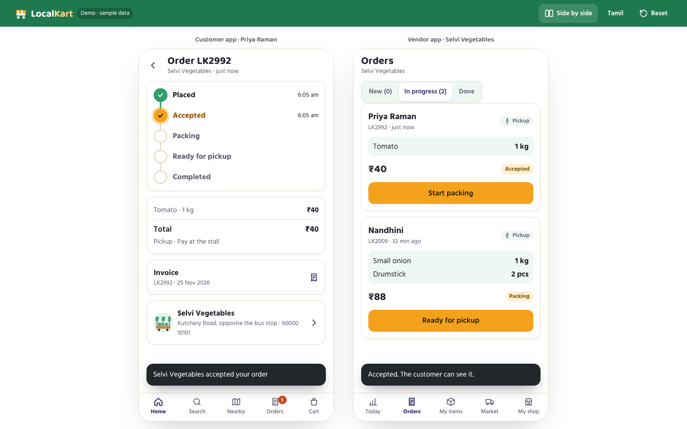 | 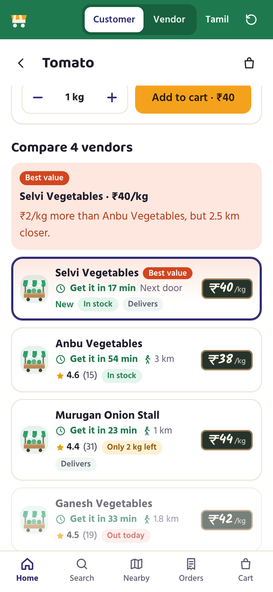 |

| Tomorrow's market list | Trip planner | Walk-in bill | Tamil |
|---|---|---|---|
| 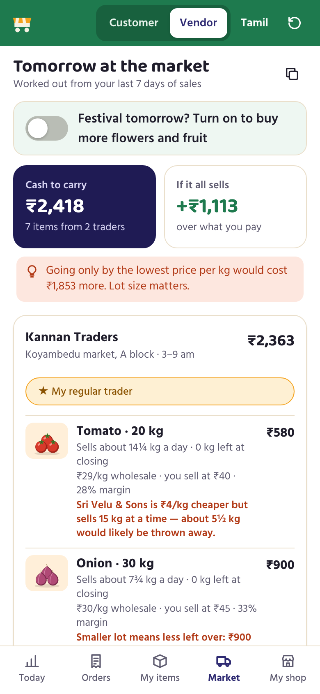 | 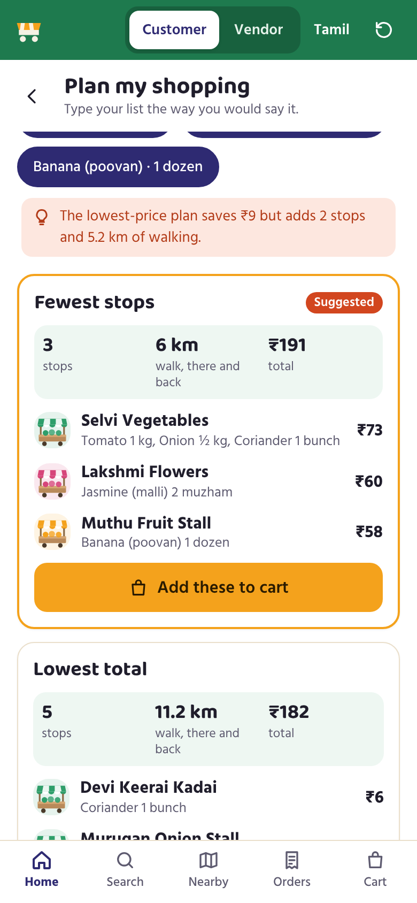 | 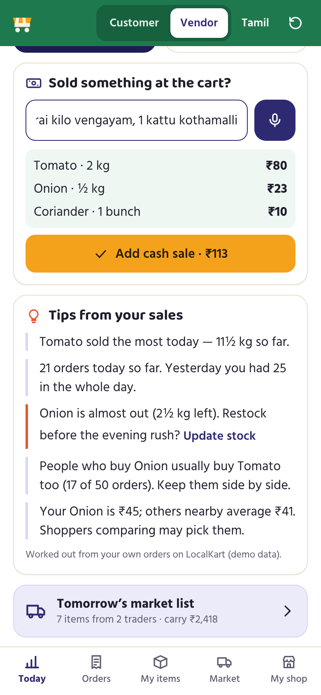 | 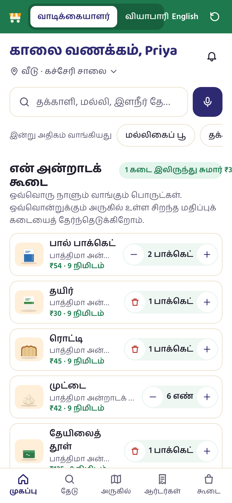 |

| Daily basket | Sort and filters | Orders to traders |
|---|---|---|
| 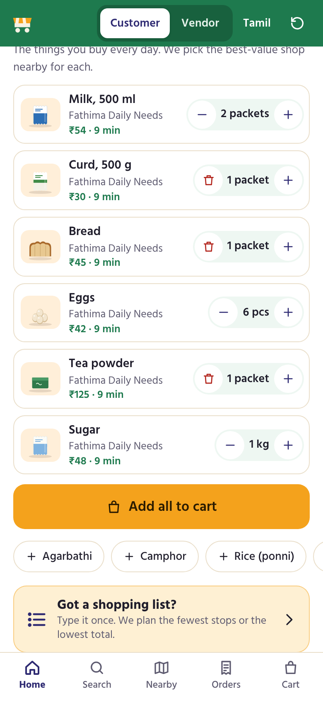 | 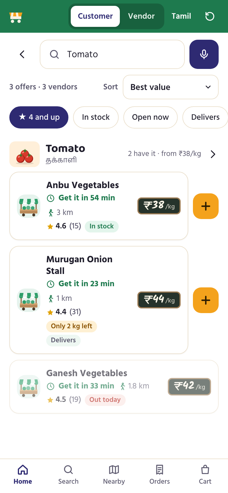 | 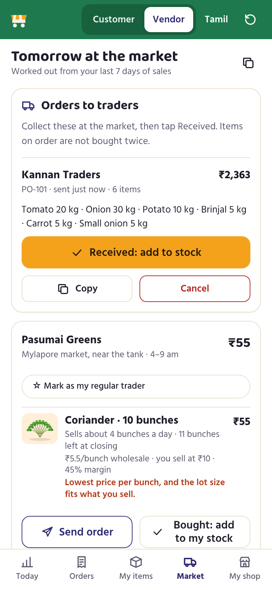 |

---

## How the logic works

Everything is plain JavaScript with visible formulas. Nothing is a black box, and every pick comes with a reason on screen.

### 1. Best value (`js/value.js` → `bestValue`)

For each open vendor with the item in stock:

| Part | Weight | Score |
|---|---|---|
| Price | 40% | cheapest price ÷ this price |
| Distance | 35% | 1 ÷ (1 + km) |
| Rating | 15% | The item's own average stars, (rating − 3) ÷ 2. If the item has no reviews yet, the shop's rating; if neither, 0.5 |
| Enough stock | 10% | 1 if they have 3× what you want, else 0.5 |

The reason line compares the pick with the cheapest option, for example *"₹2/kg more than Anbu Vegetables, but 2.5 km closer. Best rated too."* No vendor can pay to rank higher.

### 2. Tomorrow's market list (`js/market.js` → `buyingList`)

```
daily demand d = units sold in the last 7 days (online + walk-in) ÷ 7      (× 1.5 for flowers/fruit on festival days)
left at close  = stock − d × share of today's selling hours still ahead
target         = d × days of cover × 1.2                                    (1 day fresh, 3 days hardy veg, 7 days packets)
need           = target − left at close − already on order                  (fresh leftovers count at half; orders arrive fresh)

for each trader that sells it:
  qty            = need rounded up to the trader's lot
  likely waste   = for fresh items, anything beyond target + half a day's sales
  effective cost = qty × price + likely waste × price
pick the trader with the lowest effective cost,
  unless one of the vendor's regular traders is within 5% of it: then pick the regular trader
```

Lot size changes the answer, as these two examples from the demo data show:

- Tomato, need 12 kg. Kannan Traders sells 5 kg lots at ₹29, so 15 kg = ₹435. Sri Velu & Sons sells 15 kg crates at ₹25, so 15 kg = ₹375. **Velu wins**: bigger lot, cheaper overall.
- Onion, need 27 kg. Kannan: 30 kg = ₹900. Velu sells 25 kg bags at ₹26, so 50 kg = ₹1,300. **Kannan wins**, even though Velu is cheaper per kg.

The screen shows cash to carry, profit if it all sells, and how much going only by price per kg would have cost. Wholesale prices are sample figures.

**Orders to traders.** *Send order* saves one purchase order for a trader's part of the list (PO-101, PO-102 …) and *Copy* gives the WhatsApp text. Until it is marked *Received*, its amounts count as stock on the way, so the list doesn't ask for them again. *Received: add to stock* adds the ordered amounts and records the spend under *Bought today*. Street vendors usually buy on credit from one regular trader, so a trader marked *My regular trader* is preferred when within 5% of the cheapest option, and the list says how much more it costs.

### 3. Trip planner (`js/smart.js` → `planTrip`)

The list is read by the same parser as the quick bill. Two plans are compared:

- **Lowest total:** each item from its cheapest vendor within 3 km.
- **Fewest stops:** repeatedly pick the vendor who covers the most remaining items (cheaper, then nearer, on a tie).

Walking distance is a nearest-neighbour route from where you are, through every stop and back. We suggest the lowest-total plan only if it saves at least ₹15 per extra stop.

### 4. Picked for you (`js/smart.js` → `picksForMe`)

```
score = 3 × times bought together with things you've bought before
      + 0.5 × orders for it nearby today
      + 4 if it suits the time of day (milk and greens in the morning, jasmine and sundal in the evening)
```

The biggest part becomes the reason shown on the card: "Because you buy tomato", "Popular this evening".

### 5. Quick bill and shopping list parser (`js/smart.js` → `parseList`)

Splits on commas, "and", "um" and new lines. Reads numbers, fractions (1/2), and Tamil/Tanglish number words (*arai* = ½, *kaal* = ¼, *rendu* = 2) and units (kg, g, *kattu*, *muzham*, dozen). Names match English, Tamil script and common spellings ("thakkali", "vengayam", "kothamalli"). When two items share a name (*malli* is coriander and jasmine), the unit decides.

### 6. Evening clearance

Vendors choose 10, 20 or 30% off. It applies only to fresh items (greens, flowers, soft fruit, tomato). After 4 pm a tip suggests it when fresh stock is still on the cart. Shoppers nearby see an "Evening clearance" row, and the vendor's dashboard shows how much was sold in clearance instead of thrown away.

---

### 7. Daily basket and get-it-in time (`js/store.js` → `readyMin`, `js/customer.js` → `basketLine`)

- **Get it in** = the shop's prep time + walk time (`walkMin`: km × 13 minutes, at least 2). The *Fastest to get* sort and *Get it in 15 min* filter use it. *Ready in about N min* on the product page and cart is the shop's packing time alone.
- **Next door** = the shop is within 500 m.
- **Basket line**: each item goes to the best-value shop (section 1) that has at least the basket quantity in stock. If no shop has that much, the line says so. If nobody sells it, it says so.
- **Basket total** = the sum of those best-value prices at today's prices. It is an estimate and is labelled "About".

## Architecture

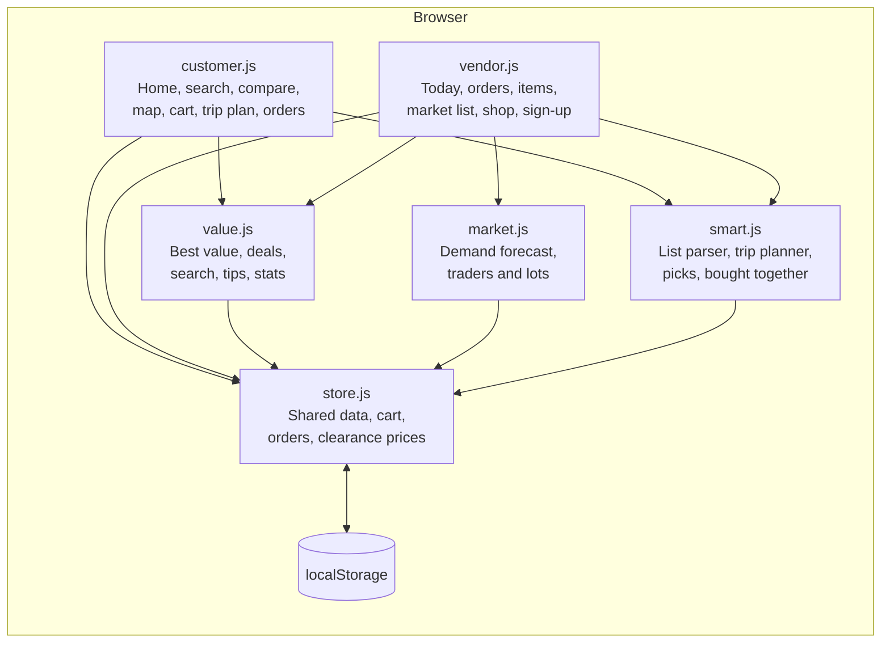

Both apps read and write the same data object, so an order placed by the customer is on the vendor's screen straight away. Two browser tabs stay in sync through the `storage` event.

```
localkart/
├── index.html          page shell; loads the scripts in order
├── css/style.css       all styles; palette, easy mode and dark mode
├── js/seed.js          sample vendors, catalogue (English, Tamil, typed spellings), traders, lots
├── js/store.js         shared data, saving, cart and order actions, clearance prices
├── js/i18n.js          English → Tamil, quantity labels (¼ kg, 2 muzham)
├── js/ui.js            icons, price slates, steppers, progress
├── js/art.js           hand-drawn SVG produce, stalls, the pushcart
├── js/value.js         best value, fair prices, search, vendor tips and stats
├── js/market.js        supply chain: demand forecast and market buying list
├── js/smart.js         list parser, quick bill, trip planner, picks, bought together
├── js/invoice.js       invoices for customer and vendor order pages (demo, not GST)
├── js/customer.js      customer screens, daily basket, 15-minute shelf
├── js/vendor.js        vendor screens
├── js/app.js           navigation, the two phones, top bar, landing page
├── sw.js               offline support (network first; only when served over http)
├── manifest.webmanifest  install as an app
├── icons/              app icon (SVG and PNG sizes)
└── docs/               demo script, slide storyline, screenshots
```

## Quality checks

Measured on the final build, served with compression the way GitHub Pages serves it.

| Check | Result |
|---|---|
| Lighthouse, phone (simulated slow 4G) | Performance 99 · Accessibility 100 · Best practices 100 · SEO 100. First paint 0.8 s, largest paint 1.7 s, no layout shift |
| Lighthouse, desktop | 100 · 100 · 100 · 100 |
| axe-core accessibility scan, WCAG 2.2 AA | No issues on any of 21 screens at phone and desktop size, light and dark, English and Tamil (105 combinations) |
| Layout | Nothing overflows sideways on any screen at 390 px or 1280 px |
| Console | No errors or warnings |
| Automated flows (Playwright, in [`tests/`](tests/README.md)) | 68 checks across sorting and filters, reviews, invoices, the daily basket, the 15-minute shelf, orders to traders and Tamil; all pass. More smoke tests of every screen were run during development |

Other details: keyboard focus is visible, there is a skip link, motion is turned off for people who ask for less motion, dark mode follows the phone's setting, and fonts load without holding up the first paint.

## Run it

No build step and nothing to install.

- **Locally:** open `index.html` in Chrome, or run `python3 -m http.server 8000` in the folder and open `http://localhost:8000`.
- **Install as an app:** when served over http(s) (GitHub Pages or the local server), Chrome and Safari offer *Install* / *Add to Home Screen*, and the app keeps working offline. Opened straight from the file, these two are switched off and everything else works.
- **GitHub Pages:** Settings → Pages → Deploy from branch → `main` / root.
- **Environment variables:** none. There is no backend.

**Demo accounts:** there is no login.

| Role | Who | How |
|---|---|---|
| Customer | Priya Raman, Kutchery Road, Mylapore | "I'm shopping", or *Customer* in the top bar |
| Vendor | Selvi Murugan, Selvi Vegetables | "I sell on the street", or *Vendor* in the top bar. Switch between all 14 sample vendors under *My shop → Demo accounts* |

On a laptop, **See both apps side by side** shows both phones at once. **Reset** puts everything back to the starting data. The landing page is always in English; Tamil switches on inside the apps.

## Research and sources

The design choices rest on public data. The sources below were checked on 25 Nov 2026. The app does not pull data from them.

| # | Claim used | Source | Link | Where it shows in LocalKart |
|---|---|---|---|---|
| 1 | UPI use among PM SVANidhi beneficiaries rose from about 45% (2023) to 83% (2025) | Press Information Bureau (PIB), feature on PM SVANidhi | https://www.pib.gov.in/blogs/blogsdescr.aspx?feaaid=539 | Vendor sign-up (optional UPI ID); cart UPI note |
| 2 | Restructured PM SVANidhi scheme targets 1.15 crore street vendors; lending extended to 31 March 2030; outlay ₹7,332 crore | PIB fact sheet, "SVANidhi: Empowering Street Vendors", 20 Dec 2025; Union Cabinet approval, 27 Aug 2025 (All India Radio) | https://static.pib.gov.in/WriteReadData/specificdocs/documents/2025/dec/doc20251220739401.pdf ; https://newsonair.gov.in/union-cabinet-approves-restructuring-of-pm-svanidhi-scheme | Market context. Not integrated with the scheme |
| 3 | The world wasted 1.05 billion tonnes of food in 2022 (global figure) | UNEP, Food Waste Index Report 2024, 27 March 2024 | https://www.unep.org/resources/publication/unep-food-waste-index-report-2024 | Evening clearance; likely-waste costing in the market list |
| 4 | Street Vendors (Protection of Livelihood and Regulation of Street Vending) Act, 2014 (Act No. 7 of 2014): protects urban street vendors; provides for certificates of vending | India Code; Ministry of Housing and Urban Affairs (MoHUA) | https://www.indiacode.nic.in/handle/123456789/22354 ; https://mohua.gov.in/cms/thestreetvendorsact2014.php | Not built. Future scope: vending certificates and vendor protection |

Caveats:
- PIB material gives two cashback amounts (₹1,200 in the December 2025 fact sheet, ₹1,600 in the 2026 material). LocalKart quotes neither.
- The UNEP figure is global, not India-specific.
- Vendors, prices, ratings and wholesale rates in the prototype are sample data, not taken from these sources.

## Limits of this prototype

- Payments are not real. "UPI now" is labelled demo; nothing is charged. Delivery is not dispatched.
- Data lives in one browser. Two tabs on one computer sync, two phones don't.
- Location is two saved places on a hand-drawn map of Mylapore, not GPS. Distance is straight line × 1.25.
- Vendors, ratings, reviews, past orders and wholesale prices are sample data. Reviews you post are saved in this browser only, and nobody else sees them.
- Invoices are demo documents. They are not valid GST bills, and no tax figures are invented: prices are shown as they are.
- *Get it in* times are estimates: the shop's prep time plus a walk at about 13 minutes per km. Rider time, live queues and real pickup times are not modelled. Delivery time is not shown.
- Orders to traders are saved in the app and copied as text; nothing is sent to the trader automatically.
- Daily items are sample stock at rough prices. Medicines are not sold here: that needs a licensed pharmacy and is outside this prototype.
- Forecasts and picks use simple, explainable formulas on a small dataset, not a trained model.
- Voice input uses the browser's speech recognition (Chrome/Edge) and needs microphone permission, so it won't work in embedded previews.
- Tamil translations were written by us and should be reviewed by a native speaker before a real launch. The Tamil for the newest screens (sorting, reviews, invoices) is a first draft.

## Roadmap

| Area | Plan |
|---|---|
| Backend | API with PostgreSQL for vendors, items, orders and purchases. The buying list runs as a nightly job and is sent to the vendor on WhatsApp. |
| Accounts | Phone number + OTP for vendors and shoppers. |
| Payments | UPI collect / QR to the vendor's own UPI ID through a licensed gateway. LocalKart never holds the money. |
| Ordering | WhatsApp ordering: shoppers message the vendor's number, orders land in the same app. |
| Voice | Voice-first vendor app: "thakkali naarpadhu rupaa" sets tomato to ₹40; spoken walk-in bills. |
| Market prices | Daily wholesale prices from Koyambedu traders (or the market's published rates) instead of sample figures. |
| Location | GPS and "I'm here today" pins for carts that move. |
| Pilot | 10 vendors on one street for four weeks, measuring orders, waste and time spent buying. |

## Business model (plan)

- Free for vendors during the pilot. Street vendors work on thin margins, and the first job is getting them onboard.
- Later, a small fixed fee per online order (not a percentage), paid only on orders that came through LocalKart.
- Optional paid market list with live wholesale prices and WhatsApp delivery at 4 am.
- Partnerships with wholesale traders for priority pickup, never paid ranking for shoppers.

## Privacy

Everything stays in the visitor's own browser. Nothing is sent anywhere.
